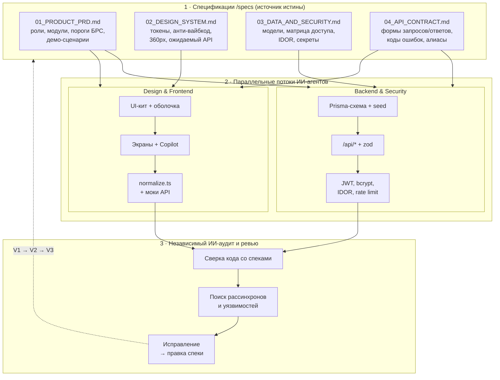

<div align="center">

# Орбита · Цифровой деканат будущего

**Учёба, деканат и кампус в одном окне — с телефона, за пару касаний.**

Next.js 15 · React 19 · TypeScript · Tailwind CSS v4 · Prisma + SQLite · jose (JWT) · bcryptjs · zod

</div>

> [!IMPORTANT]
> «Орбита» — **конкурсный прототип** для хакатона «Цифровой деканат будущего». Это **не официальный сервис** какого-либо вуза. Логотип оригинальный (две орбиты и спутник, `src/components/brand/Logo.tsx`). Все люди, группы, оценки, заявки и пароли в демо-базе **вымышлены**, совпадения случайны.

---

## Содержание

- [Проблема](#проблема)
- [Решение](#решение)
- [Ключевые модули V1–V3](#ключевые-модули-v1v3)
- [Архитектура SDD и оркестрация ИИ-агентов](#архитектура-sdd-и-оркестрация-ии-агентов)
- [Безопасность (AppSec)](#безопасность-appsec)
- [Быстрый запуск](#быстрый-запуск)
- [Тестовые аккаунты](#тестовые-аккаунты)
- [Структура репозитория](#структура-репозитория)
- [Документация](#документация)

---

## Проблема

Студенческая жизнь разложена по десятку мест: расписание — в одной системе, баллы БРС — в другой, домашние задания — в LMS, справки — в окошке деканата, переносы пар — в чате старосты, пароль от Wi-Fi — в письме полугодовой давности. С телефона всё это открывается плохо или не открывается вообще.

Студент тратит время на поиск, а не на учёбу: где пара, сколько баллов не хватает до допуска, когда дедлайн, сколько ждать справку. Сотрудник деканата разбирает однотипные бумажные заявки и не может быстро оповестить группу о переносе аудитории.

## Решение

«Орбита» объединяет **три контура** в одном веб-приложении, адаптированном под экран от **360 px**:

| Контур | Что внутри |
|--------|-----------|
| **Учебный** | Расписание с переносами, БРС и симулятор «Что если?», онлайн-задачи с решением прямо на сайте, методички с ИИ-квизами, кабинет преподавателя |
| **Административный** | Онлайн-заявки и справки с реестровым номером, очередь деканата, подпись ЭЦП, печатный бланк с QR, массовые объявления |
| **Кампусный** | Бронирование коворкингов, Wi-Fi и IT-доступы, Smart-пропуск, афиша мероприятий, запись в спортивные секции, мессенджер |

Главный экран не таблица, а **«Фокус дня»**: ближайшая пара (с бейджем «Перенос», если аудиторию сменили), горящие дедлайны с обратным отсчётом, статус заявок и средний балл. Приложение само говорит, что важно сегодня.

---

## Ключевые модули V1–V3

### 1. Контекстный дашборд «Фокус дня» и аналитика кампуса

- Ближайшее занятие по московскому времени, «горящие» дедлайны (≤ 72 ч или просрочены), активные заявки, средний балл БРС, непрочитанные уведомления.
- Виджет **«Время в вузе и учебная активность»**: часы в кампусе за неделю и семестр, посещаемость, место в рейтинге группы, активность по дням и структура недели (лекции / практики / лабораторные / брони / самостоятельная работа). Графики на SVG/CSS, к каждому есть табличная альтернатива для скринридеров.
- Отдельные дашборды для преподавателя (работы на проверке) и деканата (статистика заявок).

### 2. Умное расписание

- Неделя Пн–Сб; перенесённая пара подсвечена и показывает старую аудиторию.
- Три режима: **моё расписание**, **поиск по группе** (регистронезависимо, латинские `M`/`E` приравниваются к кириллице) и **по аудитории/корпусу** («Лаб. 105», «Корпус Б»).
- **Бронирование помещений**: 5 пространств (коворкинг, проектная аудитория, переговорная, читальный зал, лекторий), слоты совпадают с парами. Двойная бронь невозможна даже при одновременных запросах: уникальный индекс `activeSlotKey` даёт понятный `409`.
- **Экспорт недели в `.ics`** (RFC 5545, МСК → UTC, напоминание за 15 минут): расписание сразу появляется в Google / Apple / Outlook Calendar.

### 3. Интерактивный учебный трек

- **Онлайн-решатель задач**: рабочая зона Split-View (условие слева, редактор справа) на десктопе и вкладки на мобильном. Редактор с нумерацией строк на JetBrains Mono, шаблон кода подставляется сам, сдать можно текстом решения и/или ссылкой `https://`.
- **Кабинет преподавателя (`TEACHER`)**: выдать группе задание с условием в Markdown и шаблоном, увидеть сданные решения, поставить балл с рецензией. Балл **автоматически попадает в БРС** (в одной транзакции с оценкой и уведомлением).
- **Методички со встроенным ридером** и **ИИ-квизом «Проверь себя»**: 3 вопроса с 4 вариантами, мгновенной проверкой и пояснениями. С LLM-ключом вопросы генерирует модель, без ключа берутся из банка вопросов по методичке или собираются автоматически по ключевым терминам текста.

### 4. Успеваемость и Симулятор БРС «Что если?»

- Прозрачная разбивка балла по дисциплине: лабораторные (40) + рубежный контроль (40) + посещаемость (20) = 100.
- Пороги едины для бэкенда, ИИ-ассистента и интерфейса: **допуск к аттестации ≥ 50**, «отлично» и **повышенная стипендия ≥ 85** по всем дисциплинам без долгов.
- **Симулятор**: двигаете ползунки «добрать N баллов за лабы / РК / посещаемость» и сразу видите итог, оценку, долги и сохранится ли стипендия. API отдаёт готовые `pointsToAdmission` и `pointsToExcellent`, поэтому студент видит конкретное число: «не хватает 8 до допуска».

### 5. Цифровой конвейер заявок и справок

- **7 типов заявок** с динамическими полями: справка об обучении, справка для военкомата, академическая справка (ru/en), материальная помощь (категория, сумма, причина), **ПГАС** (до 10 достижений по категориям), направление на пересдачу, пропуск в общежитие.
- Жизненный цикл `NEW → IN_REVIEW → APPROVED | REJECTED` со степпером, реестровый номер `ОРБ-2026-NNNN`, отказ только с комментарием.
- **Кабинет сотрудника деканата (`ADMIN`)**: очередь заявок, кнопка «Одобрить и подписать ЭЦП», массовая рассылка объявлений и перенос аудитории для группы (студенты сразу видят новую аудиторию).
- **Печатный бланк справки** с отметкой ЭЦП и QR-кодом проверки. Генератор QR написан без внешних зависимостей. Бланк всегда печатается светлым, даже из тёмной темы.

### 6. Орбита Copilot, мессенджер и командная палитра

- **ИИ-консьерж «Орбита Copilot»** в двух режимах: «Учебный тьютор» (темы, ДЗ, план подготовки к РК) и «Деканат и регламенты» (баллы, стипендия, дедлайны, справки). Перед ответом сервер собирает **персональный контекст из БД текущего пользователя**, поэтому Copilot знает именно ваши баллы и дедлайны. Работает с любым OpenAI-совместимым LLM; без ключа отвечает по правилам на реальных данных, так что жюри может проверить чат без внешних сервисов.
- **Мессенджер** с одногруппниками, преподавателями и деканатом: поиск, шаблоны, счётчик непрочитанных, оптимистичная отправка. Кнопка «Написать преподавателю» есть прямо в ДЗ и БРС.
- **Командная палитра ⌘K / Ctrl+K**: переход в любой раздел и быстрые действия (новый пароль Wi-Fi, заказ справки, экспорт `.ics`, смена темы, вызов Copilot).

### 7. Хаб «Кампус и Сервисы»

- **IT-доступы и Wi-Fi**: персональный логин сети `Orbita-Edu-5G`, показать / скопировать пароль, **сгенерировать новый** одной кнопкой. Пароль генерируется криптостойко (`crypto.randomInt`, около 59 бит энтропии, без похожих символов `0/O`, `1/I/L`), не чаще 5 раз в час. Там же корпоративная почта и учебные лицензии (JetBrains, GitHub Student Pack, Figma, облачный грант).
- **Динамический Smart-пропуск**: QR-токен обновляется каждые 30 секунд, «живые» часы и бегущая полоса отличают пропуск от скриншота, QR скрывается, когда вкладка неактивна.
- **Афиша мероприятий**: хакатоны, митапы, карьера, наука, клубы. Запись в 1 клик, электронный билет `EVT-2026-XXXX`; счётчик мест меняется атомарно, поэтому превысить вместимость нельзя.
- **Физкультура**: трекер зачёта (например, 16/20), каталог из 7 секций, запись и переход между секциями в одной транзакции.

### Дизайн

- **Obsidian Dark** по умолчанию, светлая тема переключается одним кликом, без мигания при загрузке.
- **Анти-вайбкод правила**: без неоновых градиентов и тяжёлых теней, один акцентный цвет, `tabular-nums` на всех цифрах, иконки `lucide-react` без цветных подложек.
- **Mobile-first от 360 px**: нижний таб-бар, тач-зоны ≥ 44×44, ни одного горизонтального скролла. Матовое стекло только на оверлеях, анимации только `transform`/`opacity`, чтобы держать 60 FPS на слабых телефонах.
- **Optimistic UI**: сообщения, записи на события и в секции, бронирования, аватар отображаются мгновенно и откатываются при ошибке.

---

## Архитектура SDD и оркестрация ИИ-агентов

Проект построен по методологии **Spec-Driven Development**: сначала контракт в `/specs`, потом код. Спецификации являются единственным источником истины и для людей, и для ИИ-агентов. Любое изменение схемы или правил доступа сначала вносится в спеку.



**Как это работает на практике:**

1. **Контракт до кода.** Четыре документа в `/specs` фиксируют роли, бизнес-правила (пороги БРС, жизненный цикл заявок), модели данных, матрицу доступа и форму каждого эндпоинта.
2. **Параллельные потоки.** Бэкенд и фронтенд разрабатывались независимо в отдельных ветках и git worktree, с непересекающимися зонами владения файлами (см. [AGENTS.md](AGENTS.md)). Фронтенд работал на встроенных моках (`NEXT_PUBLIC_API_MOCK=1`) с теми же формами ответов, а слой `src/lib/normalize*.ts` принимает оба варианта имён полей. Поэтому потоки стыковались без переписывания экранов.
3. **Независимый аудит.** После каждой итерации код сверялся со спеками отдельным агентом-ревьюером. Найденные расхождения исправлялись в коде и в спеке одновременно.
4. **Инкрементальные версии.** V2 и V3 только добавляют: все сценарии и эндпоинты V1 продолжают работать, схема БД меняется лишь аддитивно.

| Версия | Что добавилось |
|--------|----------------|
| **V1** | Вход и сессия, «Фокус дня», расписание с переносами, БРС и симулятор, ДЗ, методички, 5 типов заявок с QR-справкой, деканат, объявления, Copilot, IDOR-защита |
| **V2** | Роль `TEACHER` и онлайн-ДЗ с решением на сайте, мессенджер, поиск расписания, бронирование помещений, статистика времени в вузе, заявки со структурированными полями, Obsidian Dark |
| **V3** | Хаб «Кампус и Сервисы» (Wi-Fi, Smart Pass, лицензии), афиша мероприятий, физкультура, аватары, ИИ-квиз, ⌘K, экспорт `.ics`, матовое стекло, Optimistic UI, индексы БД |

---

## Безопасность (AppSec)

| Угроза | Защита | Где в коде |
|--------|--------|-----------|
| **IDOR** (доступ к чужим объектам по id) | Владелец проверяется на каждом ресурсе: заявки, брони, задания, переписки, оценки. Для студента и чужой, и **несуществующий** id дают одинаковый `403`, поэтому перебором нельзя узнать, какие заявки существуют. id заявок намеренно последовательные (1, 2, 3…): защита не опирается на секретность идентификатора. Каждая блокировка пишется в лог `[security] IDOR blocked` | `src/app/api/requests/[id]/route.ts`, `bookings/[id]`, `teacher/assignments/[id]/grade` |
| **Кража сессии через XSS** | JWT (HS256, jose) в cookie `orbita_token` с флагами `HttpOnly; SameSite=Lax; Secure` (в production), 8 часов. JavaScript страницы токен не видит. При проверке жёстко заданы алгоритм, `iss` и `aud` | `src/lib/jwt.ts` |
| **Подмена личности** | `userId` и `role` берутся **только из проверенного токена**; поля `userId`/`role` в теле запроса игнорируются. Сессия сверяется с БД на каждом запросе | `src/lib/session.ts` |
| **Утечка паролей** | bcrypt (cost 10). При несуществующем email всё равно выполняется сравнение с фиктивным хешем, чтобы время ответа не выдавало наличие аккаунта. Ответ на любую ошибку входа одинаковый | `src/lib/password.ts`, `api/auth/login` |
| **Перебор паролей** | 5 неудачных попыток на пару «IP + email» за 15 минут → `429` | `src/lib/rate-limit.ts` |
| **CSRF** | `SameSite=Lax` и сверка `Origin` с `Host` для всех изменяющих запросов в middleware | `src/middleware.ts` |
| **Утечка секретов** | `JWT_SECRET` и `AI_API_KEY` читаются только на сервере, без префикса `NEXT_PUBLIC_`, поэтому не попадают в клиентский бандл. Ошибки LLM логируются без ключа, `500` отдаётся без stack trace | `src/lib/ai/llm.ts`, `.env.example` |
| **Вредоносные загрузки** | Аватар проверяется по **сигнатуре файла** (PNG/JPEG/WebP), а не только по заголовку: замаскированный SVG/HTML отклоняется. Отдаётся с `nosniff` и `CSP: default-src 'none'` | `api/profile/avatar` |
| **Невалидный ввод** | Все тела запросов проверяются схемами zod, лишние поля отбрасываются | `src/lib/validation.ts` |
| **Утечка персональных данных** | Сериализация пользователя по белому списку полей (`passwordHash` и `wifiPassword` никогда не уходят в общие ответы); в LLM уходят только данные текущего пользователя | `src/lib/serializers.ts`, `src/lib/ai/context.ts` |

**Проверить самим:** войдите студентом → **Профиль** → «Проверка безопасности (IDOR-тест)». Приложение запросит чужую заявку `/api/requests/99999` и покажет `403 Forbidden`.

**Автономность:** база данных в файле SQLite, внешних сервисов нет. Стенд работает из РФ без VPN, ИИ-ассистент работает и без ключа.

---

## Быстрый запуск

### Вариант 1. Docker Compose (одна команда)

```bash
docker compose up --build -d     # сборка, создание схемы, демо-данные, запуск
docker compose logs -f orbita    # логи
docker compose down              # остановка (база сохраняется в томе orbita_sqlite_data)
```

Приложение откроется на `http://localhost:3000`. Переменные `JWT_SECRET`, `AI_API_KEY`, `AI_BASE_URL` можно переопределить в `.env` в корне проекта. Для публичного стенда обязательно задайте собственный `JWT_SECRET`, не используйте значение по умолчанию из `docker-compose.yml`.

### Вариант 2. Локально для разработки

**Требования:** Node.js ≥ 20, npm.

```bash
git clone https://github.com/Bossuslugi/hackaton_mgimo.git
cd hackaton_mgimo
npm install                 # postinstall выполнит prisma generate
cp .env.example .env        # в нём уже есть DATABASE_URL="file:./dev.db"
npm run db:setup            # создать SQLite-базу и заполнить демо-данными
npm run dev                 # http://localhost:3000
```

В dev-режиме без `JWT_SECRET` используется встроенный dev-секрет, чтобы стенд запускался «из коробки». Для production задайте свой секрет, без него сервер откажется выпускать токены:

```bash
node -e "console.log(require('crypto').randomBytes(48).toString('base64url'))"
# вставьте результат в JWT_SECRET=...
```

Production-сборка: `npm run build && npm run start`.

| Команда | Что делает |
|---------|-----------|
| `npm run db:setup` | Пересоздать базу с нуля и загрузить демо-данные (удобно, чтобы сбросить стенд после проверки) |
| `npm run db:studio` | Открыть Prisma Studio и посмотреть данные в браузере |
| `npm run typecheck` | Проверка типов TypeScript |
| `node scripts/dark-codemod.mjs --check` | Проверить, что у каждого цветового класса есть пара для тёмной темы |
| `NEXT_PUBLIC_API_MOCK=1 npm run dev` | Только фронтенд, на встроенных моках, без базы |
| `npm run demo:record` | Автозапись видео-демо в `Orbita_Demo.webm` и `Orbita_Demo.mp4` (Playwright, см. ниже) |

**ИИ-ассистент (необязательно).** Для ответов настоящей LLM укажите в `.env` `AI_API_KEY`, `AI_BASE_URL` и `AI_MODEL` любого OpenAI-совместимого провайдера. Без ключа Copilot и квизы работают в детерминированном режиме на данных из БД.

**Видео-демо без ручной записи экрана.** [`scripts/record-demo.mjs`](scripts/record-demo.mjs) пересоздаёт демо-данные, при необходимости сам поднимает сервер (`next start` при наличии сборки, иначе `next dev`), проходит шесть сцен (вход и «Фокус дня» → расписание и бронь → симулятор БРС и решатель с Copilot → кампус и мессенджер → контур «студент ↔ деканат ↔ справка с QR» → IDOR, темы и вёрстка 360 px) с экранными титрами и сохраняет готовый ролик в корень репозитория. Для MP4 используется системный `ffmpeg`, если его нет, то пакет `ffmpeg-static`.

```bash
npx playwright install chromium   # один раз
npm run demo:record               # флаги: --no-seed, --headed
```

---

## Тестовые аккаунты

На странице `/login` есть кнопки **«Быстрый вход для жюри»**: вход в один клик без ввода пароля (для первых четырёх аккаунтов).

| # | Роль | ФИО (вымышленное) | Логин | Пароль | Что проверить |
|---|------|-------------------|-------|--------|---------------|
| 1 | `STUDENT` · отличник | Соколов Алексей Дмитриевич, гр. М3203, бюджет | `alexey.sokolov@edu.orbita.ru` | `Student2026!` | «Фокус дня» с дедлайном и переносом аудитории → БРС 88–94 и симулятор → «Хватает ли мне на ПГАС?» в Copilot → решить задачу «Скобочная последовательность» в редакторе → забронировать коворкинг → сменить пароль Wi-Fi → записаться на мероприятие → IDOR-тест в профиле |
| 2 | `STUDENT` · зона риска | Кузнецова Мария Андреевна, гр. Э4102, договор | `maria.kuznetsova@edu.orbita.ru` | `Student2026!` | Критическое уведомление деканата → дисциплина с 42 баллами и «не хватает 8 до допуска» → сдать просроченное ДЗ → Copilot «Как избежать недопуска?» → убедиться, что одногруппники Алексея не видны в мессенджере |
| 3 | `ADMIN` · сотрудник деканата | Смирнова Елена Викторовна | `dekanat@edu.orbita.ru` | `Admin2026!` | Очередь заявок → одобрить и подписать ЭЦП → отклонить с комментарием → разослать перенос аудитории группе М3203 → войти Алексеем и увидеть новую аудиторию |
| 4 | `TEACHER` · доцент | Волков Игорь Сергеевич | `volkov.igor@edu.orbita.ru` | `Teacher2026!` | Выдать М3203 онлайн-задачу с шаблоном → открыть сданное решение → поставить балл с рецензией → проверить, что балл попал в БРС студента |
| 5 | `STUDENT` · одногруппник | Орлов Дмитрий Сергеевич, гр. М3203 | `dmitry.orlov@edu.orbita.ru` | `Student2026!` | Вход через форму. Переписка с Алексеем; попытка занять уже забронированный Алексеем слот → `409`; увидеть оценку от преподавателя и выросший балл БРС |

---

## Структура репозитория

```
specs/                     # SDD-контракты: PRD, дизайн-система, данные и безопасность, API
prisma/
  schema.prisma            # 13 моделей: User, ScheduleItem, SubjectGrade, Assignment, DocumentRequest,
                           # RoomBooking, DirectMessage, CampusEvent, SportSection и др.
  seed.ts                  # 5 демо-аккаунтов, 3 группы, расписание, оценки, методички с банком вопросов
src/
  middleware.ts            # 401 без токена, CSRF-проверка Origin
  app/(app)/               # экраны: сводка, расписание, учёба, БРС, справки, сообщения, кампус, профиль
  app/api/                 # 30 route handlers
  components/              # UI-кит, оболочка, Copilot, деканат, кабинет преподавателя, кампус
  lib/                     # jwt, session, password, validation, domain (пороги БРС), ai/*, ics, qr
scripts/dark-codemod.mjs   # проверка и дописывание dark:-пар
deliverables/              # финальные материалы для жюри: presentation/, reports/, video/
ai-docs/                   # отчёты аудита, лог промптов, отчёт о процессе, питч-дек, сценарий видео
AGENTS.md                  # правила SDD-оркестрации и зоны владения потоков
Dockerfile, docker-compose.yml
```

## Документация

| Документ | Содержание |
|----------|-----------|
| [AGENTS.md](AGENTS.md) | Правила SDD, зоны владения потоков Backend & Security и Design & Frontend, обязательные стандарты |
| [specs/01_PRODUCT_PRD.md](specs/01_PRODUCT_PRD.md) | Роли, модули, бизнес-правила, демо-сценарии V1–V3 |
| [specs/02_DESIGN_SYSTEM.md](specs/02_DESIGN_SYSTEM.md) | Токены, анти-вайбкод правила, Obsidian Dark, адаптив, компоненты |
| [specs/03_DATA_AND_SECURITY.md](specs/03_DATA_AND_SECURITY.md) | Модели данных, аутентификация, матрица доступа, IDOR |
| [specs/04_API_CONTRACT.md](specs/04_API_CONTRACT.md) | Контракты всех эндпоинтов и коды ошибок |
| [ai-docs/REVIEW_REPORT.md](ai-docs/REVIEW_REPORT.md), [REVIEW_REPORT_V2.md](ai-docs/REVIEW_REPORT_V2.md) | Независимый аудит V1 и V2: найденные дефекты и исправления |
| [ai-docs/PROMPT_LOG.md](ai-docs/PROMPT_LOG.md) | Черновой лог процесса и промптов |
| [ai-docs/FINAL_PROCESS_REPORT.md](ai-docs/FINAL_PROCESS_REPORT.md) | Отчёт о процессе разработки с ИИ |
| [ai-docs/PITCH_DECK.md](ai-docs/PITCH_DECK.md) | Презентация на 10 слайдов |
| [ai-docs/VIDEO_SCRIPT.md](ai-docs/VIDEO_SCRIPT.md) | Сценарий видео-демонстрации на 3,5 минуты |
| [deliverables/presentation/Orbita_Presentation.pptx](deliverables/presentation/Orbita_Presentation.pptx) | Финальная презентация проекта для жюри (`.pptx`) |
| [deliverables/reports/Orbita_Process_Report.pdf](deliverables/reports/Orbita_Process_Report.pdf) | Итоговый PDF-отчёт о процессе создания и применении ИИ (с реальными скриншотами) |
| [deliverables/video/mgimo.mp4](deliverables/video/mgimo.mp4) | Финальная видео-демонстрация проекта |

## Лицензия

[GNU GPL v3](LICENSE).
